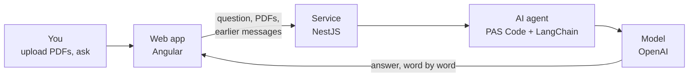

# PAS Agent Hub PDF Chat

**Upload your PDFs, ask questions in plain language, and get answers that link to the exact page.**

PAS Agent Hub PDF Chat is a full-stack AI application: an Angular web app, a NestJS service, and an AI agent that reads your documents. It was built on top of the default project that [PAS Code](https://doc.scheer-pas.com/pas-code/latest/getting-started-with-pas-code) creates with a single command, so nearly all of the work went into the feature itself.

---

## Contents

- [What you can do](#what-you-can-do)
- [Why it is useful](#why-it-is-useful)
- [Built with PAS Code](#built-with-pas-code)
- [How it works](#how-it-works)
- [Get started](#get-started)
- [Free to use](#free-to-use)
- [For developers](#for-developers)

---

## What you can do

| Feature                     | What it means for you                                                                                                                              |
| --------------------------- | -------------------------------------------------------------------------------------------------------------------------------------------------- |
| **Chat with up to 5 PDFs**  | Add several documents at once, for example a contract, its annexes, and your notes, and ask across all of them.                                    |
| **Answers from your files** | The agent answers only from the documents. If the answer is not in them, it says so instead of guessing.                                           |
| **Clickable sources**       | Every answer ends with its sources, such as `contract.pdf, page 3`. One click opens the PDF at that page.                                          |
| **Live answers**            | The answer appears word by word while the agent writes it, so you never stare at a spinner.                                                        |
| **Follow-up questions**     | Ask "and what about the renewal?" — the agent remembers the earlier questions of the conversation.                                                 |
| **Suggested questions**     | Not sure where to start? Pick "Summarize the documents", "What are the key points?", or "What questions do the documents answer?".                 |
| **Nothing stored**          | Your documents and the chat stay in the browser tab and are gone when you close it. Each question sends the PDFs to the AI model of your provider. |

A typical exchange:

> **You:** What is the notice period?
>
> **Agent:** The notice period is three months to the end of a quarter. Either party can terminate in writing.
>
> Sources: `contract.pdf, page 4` `annex-b.pdf, page 1`

## Why it is useful

- **Whole-document understanding.** The agent reads every page of every uploaded PDF, text and layout, for each question. Summaries and "what are the key points?" questions cover the complete documents, not just a few matching snippets.
- **Answers you can check.** Page-level sources that open the right page make it quick to verify an answer.
- **No setup for users.** No accounts and no waiting for documents to be processed. Upload and ask.
- **Stays on topic.** The agent does not mix in outside knowledge, so every answer is traceable to your files.

## Built with PAS Code

PAS Code is the development framework of Scheer PAS Agent Hub for building business applications and services with AI. One command created a complete, working project, and this feature was built on top of it.

```bash
pas new pas-agent-hub-pdf-chat
```

### What PAS Code provided on day one

| Out of the box              | What it gave this project                                                                               |
| --------------------------- | ------------------------------------------------------------------------------------------------------- |
| **Full-stack workspace**    | An Angular app and a NestJS service in one Nx monorepo, already connected to each other.                |
| **A working AI agent**      | An agent wired into the service, with its model configured in one JSON file.                            |
| **Shared, validated types** | One place for the request and response types, checked on the server and typed in the app.               |
| **A typed service client**  | The app calls the service through a generated client, with the address taken from configuration.        |
| **Configuration layers**    | Defaults in the repository, personal settings such as API keys in a local file that is never committed. |
| **API documentation**       | Interactive OpenAPI docs for every endpoint at `/docs`, with no extra code.                             |
| **Quality tooling**         | Unit tests, linting, formatting, and production builds, ready to run.                                   |
| **AI assistant skills**     | Guidance for Claude Code, Copilot and other assistants, so they write code the PAS way.                 |

### What we added

Because the foundation was already in place, the feature code stayed small:

| Part                       | Size                                               |
| -------------------------- | -------------------------------------------------- |
| The AI agent               | about **30 lines**: a prompt and its configuration |
| The whole service feature  | about **165 lines**: agent, endpoint, streaming    |
| Wiring it into the project | **22 lines** in two existing files                 |
| The chat interface         | a handful of focused Angular components            |

Defining the agent is mostly writing down what it should do:

```typescript
@Agent({
  configKey: 'agents.pdfChat',
  systemPrompt: 'You answer questions about the attached PDF documents. …',
  userPrompt: 'Question: {{input.question}}',
})
export class PdfChatAgent extends DefaultAgent<MultimodalInput<PdfChatPrompt>> {}
```

PAS Code takes care of the rest: connecting to the model, passing the PDFs to it, and streaming the answer back.

## How it works



1. You add PDFs in the browser. They stay in the browser tab until you ask a question.
2. When you ask a question, the app sends the question, the PDFs, and the conversation so far to the service.
3. The service hands everything to the AI agent, which asks the model and streams the answer back.
4. The app shows the answer as it arrives and turns its sources into links to the right pages.

The service keeps nothing between requests, so there is no database to run and no document to clean up.

## Get started

**You need:** Node.js 24.7 or later and an OpenAI API key.

1. **Point npm at the PAS package registry** (once per machine):

   ```bash
   npm config set @pas:registry=https://npm.gitlab.scheer-group.com/
   ```

2. **Install the dependencies:**

   ```bash
   npm install
   ```

3. **Add your OpenAI API key** to `packages/pdf-chat/service/impl/src/config/local/config.json`. This file is never committed:

   ```json
   {
     "agents": {
       "pdfChat": { "model": { "apiKey": "sk-..." } }
     }
   }
   ```

4. **Point the app at your local service** in `packages/pdf-chat/app/impl/public/config/local/config.json5`. This file is never committed either:

   ```json5
   {
     clients: {
       service: { baseUrl: 'http://localhost:8080' },
     },
   }
   ```

5. **Start the app and the service:**

   ```bash
   npm start
   ```

   or `npx pas start`. The project brings its own [PAS CLI](https://doc.scheer-pas.com/pas-code/latest/getting-started-with-pas-code) (`@pas/cli`) at the same version as the other PAS packages, so no global installation is needed.

6. **Open [http://localhost:4200](http://localhost:4200)**, add a PDF, and ask your first question.

| Part              | Address                                                  |
| ----------------- | -------------------------------------------------------- |
| Web app           | [http://localhost:4200](http://localhost:4200)           |
| Service           | [http://localhost:8080](http://localhost:8080)           |
| API documentation | [http://localhost:8080/docs](http://localhost:8080/docs) |

The complete description of the feature, its limits, configuration, and endpoint is in [packages/pdf-chat/README.md](packages/pdf-chat/README.md). If an installation step fails, see [Troubleshooting PAS Code](https://doc.scheer-pas.com/pas-code/latest/troubleshooting-pas-code).

## Free to use

**PAS Code is free, and so is everything in this project.** There is no paid edition and no license to buy: you can run, change, and extend all of it.

The same free version also lets agents go further, for example:

- **Conversation memory** that lasts beyond one browser session, so an agent can continue a conversation later.
- **Agent skills**: packaged instructions an agent looks up only when a request needs them.

Want to see what PAS Agent Hub can do for your processes? Talk to one of our team members.

<a href="https://scheer-pas.com/en/agentic-ai-and-scheer-pas-the-next-step-in-process-automation/#form">
  
</a>

---

## For developers

### Running the tests

```bash
npx nx run-many -t test
```

### Debugging services

Services are built with webpack and the compiled output (including sourcemaps) is written to the **workspace-root `dist` folder**, for example `dist/packages/pdf-chat/service/impl`. Any debug configuration must therefore map sourcemaps from `${workspaceFolder}/dist/**`, not from a project-local `dist` folder.

#### VS Code

A ready-to-use `.vscode/launch.json` is generated with two configurations:

| Configuration                     | What it does                                                                                                                                             |
| --------------------------------- | -------------------------------------------------------------------------------------------------------------------------------------------------------- |
| **Debug PAS service**             | Prompts for an Nx project name (for example `pdf-chat-service`), runs `nx serve <project>` and attaches the debugger. Set a breakpoint and press **F5**. |
| **Attach to running PAS service** | Attaches to an already-running service on inspector port `9229`, useful when you started it with `npm start`.                                            |

To debug a single service from scratch:

1. Open the **Run and Debug** panel (`⇧⌘D` / `Ctrl+Shift+D`).
2. Select **Debug PAS service** and press **F5**.
3. Enter the project name when prompted (for example `pdf-chat-service`).

#### WebStorm / IntelliJ IDEA

1. Start the service with the inspector enabled:
   ```bash
   npx nx serve pdf-chat-service --inspect
   ```
   Nx forwards `--inspect` to the Node process, which listens on port `9229`.
2. Create a **Run/Debug Configuration** → **Attach to Node.js/Chrome**.
3. Set **Host** to `localhost` and **Port** to `9229`, then start it.

WebStorm resolves sourcemaps from `dist/` automatically, so breakpoints in your TypeScript sources are hit.

### AI coding assistants

This project includes agent skills for PAS-specific guidance. To enable them in VS Code, see the [Agent Skills documentation](https://code.visualstudio.com/docs/copilot/customization/agent-skills). Project information for coding agents is in [.agents/AGENTS.md](.agents/AGENTS.md).
